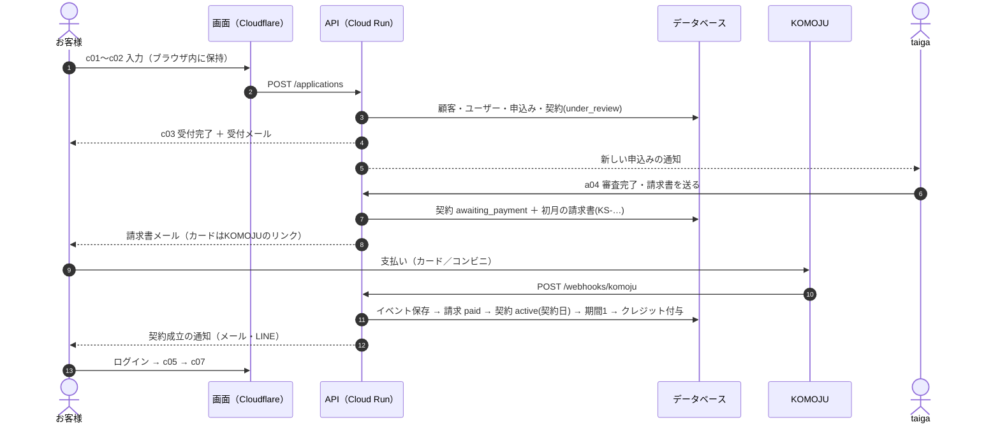
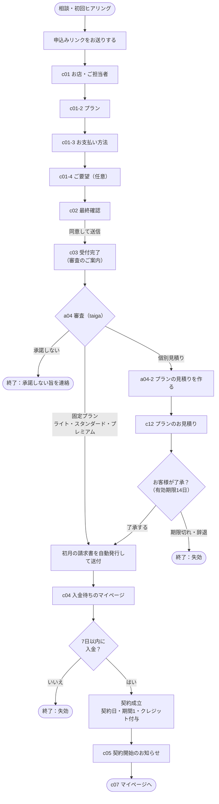
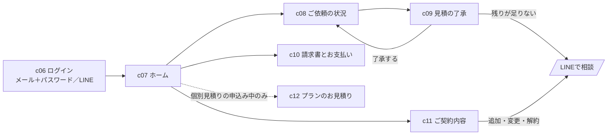
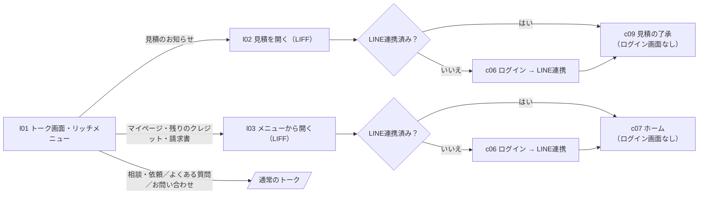
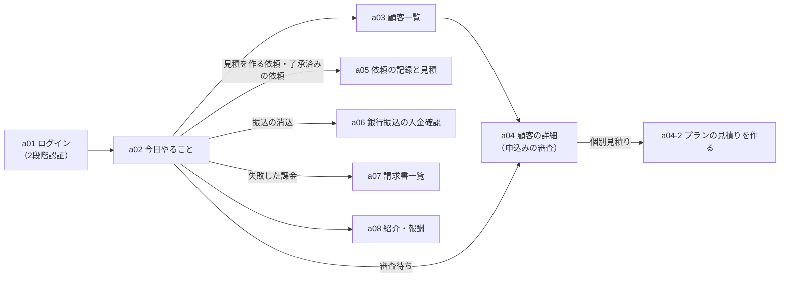

# 画面遷移・実装仕様 v1

> **2026-10-29 更新（taiga決定）：プレオープンの範囲を絞る。**
> - **コンビニ払いは当面なし。** 支払方法は「クレジットカード（KOMOJU定期課金）」と「銀行振込」の2つだけ。コンビニ手数料の請求行・支払番号・コンビニ用の状態や画面は作らない（コンビニ手数料の税の扱いも不要）。あとで足せるよう、DBの `payment_method` の値などは残してよいが、画面・処理・申込フォームの選択肢には出さない。
> - **LINE公式アカウントは一旦なし。** LINE通知、LINEログイン／LINE連携（MY-02、F-13）、LIFF、リッチメニューは作らない。ログインは**メール＋パスワードのみ**。お客様への通知は**メールとマイページ**、お客様からの連絡窓口は**メール**。通知の `channel` は `email` のみ使う（`line` は将来用に残す）。
> - **連絡用メールアドレスは `info@cingulata.jp`**（設定値 `contact_email`、規約・特商法・メール送信元に使う。taiga確定 2026-10-30）。
> - 本文中の「コンビニ」「LINE」の記述は、上記の範囲外の将来案として読み、実装しない。

2026-10-25 作成。実装担当者向け。画面の見た目は画面モック（https://claude.ai/artifact/99G6S2rPdyBTFWCYg9XE7K）、設計の正本は system-design-v1.md。URL・API名は提案です。画面はデータベースに直接つながらず、すべてAPI経由。お客様のAPIは、ログインした人の顧客IDで必ず絞ります。

## 1. 画面とURL

| 画面ID | 画面 | URL | 見られる人 | 前提の状態 | 呼ぶAPI | 操作で起きること | メモ |
|---|---|---|---|---|---|---|---|
| c01 | 手順1 お店・ご担当者 | /apply/shop | 誰でも（未ログイン） | — | GET /public/config | ブラウザ内に下書き | F-01,02,04,05,12。5項目以内。前の手順へ戻っても入力は残る |
| c01-2 | 手順2 プラン | /apply/plan | 誰でも | c01が入力済み | GET /public/plans | ブラウザ内に下書き | 個別見積りも選べる。紹介コード欄は手順4（リンクから来たら自動入力） |
| c01-3 | 手順3 お支払い方法 | /apply/payment | 誰でも | c01-2が入力済み | — | ブラウザ内に下書き | F-03,08,09。コンビニは手数料の額を選択肢の横に表示。カード番号の欄は作らない |
| c01-4 | 手順4 ご要望（任意） | /apply/notes | 誰でも | c01-3が入力済み | GET /public/partners/:code（紹介コードの確認） | ブラウザ内に下書き | F-10,11。要配慮情報の注意書き |
| c02 | 最終確認 | /apply/confirm | 誰でも | 全手順が入力済み | POST /applications | 送信で、顧客・ログイン用ユーザー・申込み・契約（under_review）を1つのトランザクションで作る | K-01〜08。C-01,C-02が必須。個別見積りは金額の代わりに「審査のあとにお見積り」 |
| c03 | 申込みの受付完了 | /apply/done | 誰でも（送信直後） | POST /applications が成功 | — | 受付メール（NT-01）と管理者への通知を送る | まだ契約は成立していない旨。審査→請求書→入金で成立の流れを表示 |
| c04 | 入金待ち／審査中のマイページ | /me/waiting | customer（under_review, quoting, awaiting_payment） | 契約の状態が上のいずれか | GET /me, GET /me/invoices | — | 状態ごとに表示を変える。審査中・見積り準備中の表示は要モック確認（現在は入金待ちのみ）。請求書と支払い方法だけ見せる |
| c05 | 契約開始のお知らせ | /me/welcome | customer（active） | 契約が成立して初回のログイン（welcome_shown_at が空） | GET /me, POST /me/welcome-seen | welcome_shown_at を記録 | 依頼の流れとLINE連携の案内。2回目以降は /me へ |
| c06 | ログイン | /login | 誰でも | — | Identity Platform（メール＋パスワード）, POST /auth/line | IDトークンを取得 | LINEで続けるは LIFF/LINE Login → Cloud Run で検証 → カスタムトークン。ログイン後の行き先は下の表 |
| c07 | マイページ（ホーム） | /me | customer（active, cancel_scheduled） | 契約が利用中または解約予定 | GET /me, GET /me/credits, GET /me/requests?open=1, GET /me/invoices?unpaid=1 | — | 契約の状態、今期の残りクレジットと期限、了承待ちの見積、未払いの請求 |
| c08 | ご依頼の状況 | /me/requests | customer（active, cancel_scheduled） | 同上 | GET /me/requests | — | 受付済み／見積・了承待ち／作業中／完了。目安日、使ったクレジット |
| c09 | 見積の了承 | /me/requests/:id/estimate | customer（本人の依頼のみ） | 依頼が awaiting_approval で、見積の版が最新 | GET /me/requests/:id, POST /me/estimates/:id/approve | 了承：estimates.approved_at、依頼を in_progress、クレジットを予約（reserve） | 残りが足りないときはボタンを押せず「LINEで相談」。最新でない版は了承できない（409）。二重送信は同じ結果を返す |
| c10 | 請求書とお支払い | /me/invoices | customer | — | GET /me/invoices, GET /me/invoices/:id/pdf | — | PDF（期限つきURL）、税抜の小計・消費税・税込合計、支払い済み／未払い、支払いの案内（カードのリンク／支払番号／振込先） |
| c11 | ご契約内容 | /me/contract | customer | — | GET /me/contract, POST /me/line/link | LINE連携の登録 | プラン、契約日、次の請求日、LINE連携。追加・変更・解約は「LINEで連絡」 |
| c12 | プランのお見積り（個別見積り） | /me/plan-quote | customer（awaiting_quote_approval） | 契約が見積り了承待ち | GET /me/plan-quote, POST /me/plan-quote/:id/approve | 了承：plan_quotes.approved_at、契約を awaiting_payment、初月の請求書を自動発行 | 有効期限切れは了承できない。出し直した古い版は了承できない |
| l01 | トーク画面とリッチメニュー | （LINE内） | LINEの友だち | — | — | — | リッチメニュー6つ：マイページ／相談・依頼／残りのクレジット／請求書／よくある質問／お問い合わせ。LINE公式の管理画面で設定（アプリ側は作らない） |
| l02 | 見積を開く（LIFF） | /liff?to=estimate&id=:requestId | LIFF（LINE内ブラウザ） | LINE連携済み、または連携してログイン | POST /auth/line → GET /me/requests/:id | — | 見積の通知メッセージから開く。連携済みならログイン画面を出さずに c09 を表示 |
| l03 | メニューからマイページ（LIFF） | /liff?to=home | LIFF | 同上 | POST /auth/line → GET /me | — | 連携済みなら c07 へ。未連携なら c06 から連携 |
| a01 | ログイン（2段階認証） | /admin/login | admin | — | Identity Platform（メール＋パスワード＋TOTP） | 第2要素つきIDトークン | 第2要素がないトークンは管理APIが拒否（403） |
| a02 | 今日やること（トップ） | /admin | admin（2段階認証済み） | — | GET /admin/dashboard | — | 審査待ち、プランの見積りを作る申込み、見積を作る依頼、振込の消込、失敗した課金、了承済みの依頼、KPI |
| a03 | 顧客一覧 | /admin/customers | admin（2FA） | — | GET /admin/customers?status=&q= | — | 状態で絞り込み |
| a04 | 顧客の詳細（申込みの審査） | /admin/customers/:id | admin（2FA） | — | GET /admin/customers/:id, POST /admin/applications/:id/approve, POST /admin/applications/:id/decline, POST /admin/contracts/:id/cancel-request, POST /admin/contracts/:id/early-access | 審査完了：固定プラン→請求書を自動発行（awaiting_payment）／個別見積り→quoting。承諾しない→declined。解約予定、先に使えるようにする | 契約・期間・クレジットの動き・請求・依頼を1画面に。操作は audit_logs に残す |
| a04-2 | プランの見積りを作る（個別見積り） | /admin/customers/:id/plan-quote | admin（2FA） | 契約が quoting または awaiting_quote_approval | POST /admin/contracts/:id/plan-quotes | 送信で契約を awaiting_quote_approval、LINE・メールで通知。出し直しは新しい版 | 月額（税抜）、クレジット数、内容、有効期限（案：14日）。税込の目安を併記する案（要確認） |
| a05 | 依頼の記録と見積 | /admin/requests（/:id） | admin（2FA） | — | GET/POST /admin/requests, POST /admin/requests/:id/estimates, POST /admin/requests/:id/complete | 見積送信で awaiting_approval（LINE通知）。完了で予約を戻し実績を消費 | 見積は作業内容（必須）、完了の状態（必須）、含まれないもの、ご用意いただくもの |
| a06 | 銀行振込の入金確認 | /admin/bank-transfers | admin（2FA） | — | GET /admin/bank-transfers/pending, POST /admin/invoices/:id/confirm-payment | 請求を paid、クレジットを付与。初月なら契約成立（active、契約日、期間1） | 入金日を入力。二重に押しても1回だけ反映 |
| a07 | 請求書一覧 | /admin/invoices | admin（2FA） | — | GET /admin/invoices, POST /admin/invoices/:id/void | 取消（void）と出し直し（新しい番号） | 番号は欠番にしない。取消した番号は残す |
| a08 | 紹介・報酬 | /admin/referrals | admin（2FA） | — | GET /admin/referrals?month= | — | 月ごと・パートナーごとの報酬。基準は入金のあった月額（表示価格・税抜）。支払いは報酬＋消費税 |

## 2. ログイン後の行き先

| 契約の状態 | 行き先 | 画面 |
|---|---|---|
| under_review（審査待ち） | /me/waiting | c04 |
| quoting（見積り作成中） | /me/waiting | c04 |
| awaiting_quote_approval（見積り了承待ち） | /me/plan-quote | c12 |
| awaiting_payment（入金待ち） | /me/waiting | c04 |
| active／cancel_scheduled（利用中／解約予定） | 初回のみ /me/welcome、以降は /me | c05 → c07 |
| ended（終了） | /me/invoices だけ（終了から1年） | c10 |
| declined／lapsed（承諾しない／失効） | 「お申込みは終了しました」の1画面。データは見せない | — |

未ログインで /me や /admin を開くと /login（管理は /admin/login）へ。役割が違うURLは 404。

## 3. 操作と状態の変化

| 操作・できごと | 元の状態 | 新しい状態 | API／きっかけ | メモ |
|---|---|---|---|---|
| 申込みを送信（c02） | — | under_review | POST /applications | customer（未ログイン） |
| 審査完了・請求書を送る（a04） | under_review | awaiting_payment | POST /admin/applications/:id/approve | admin。初月の請求書を自動発行 |
| 審査完了・見積りを作る（a04） | under_review | quoting | 同上（個別見積りのプラン） | admin |
| 承諾しない（a04） | under_review | declined | POST /admin/applications/:id/decline | admin。連絡を送る |
| プランの見積りを送る（a04-2） | quoting | awaiting_quote_approval | POST /admin/contracts/:id/plan-quotes | admin。LINE・メールで通知 |
| 見積りを出し直す（a04-2） | awaiting_quote_approval | quoting | 同上（新しい版） | admin。古い版は無効 |
| 見積りを了承（c12） | awaiting_quote_approval | awaiting_payment | POST /me/plan-quote/:id/approve | customer。初月の請求書を自動発行 |
| 見積りの期限切れ・辞退 | awaiting_quote_approval | lapsed | 毎日の定時処理／管理画面 | system／admin |
| 初月分の入金 | awaiting_payment | active | KOMOJU Webhook／POST /admin/invoices/:id/confirm-payment（a06） | 契約日・期間1・クレジット付与 |
| 7日以内に入金なし | awaiting_payment | lapsed | 毎日の定時処理 | system。お客様に知らせる |
| 解約の申出を記録（a04） | active | cancel_scheduled | POST /admin/contracts/:id/cancel-request | admin。定期課金を止める準備 |
| 申出の取り消し（a04） | cancel_scheduled | active | POST /admin/contracts/:id/cancel-revoke | admin |
| 期間の終わり | cancel_scheduled | ended | 毎日の定時処理 | system。残りクレジット失効、報酬停止 |

## 4. APIの一覧

共通：/api/v1 の下。書き込みは冪等にする。

| 区分 | API | 内容 |
|---|---|---|
| 公開 | GET /public/config | サービス名、規約・ポリシーの版、コンビニ手数料の額など（settings の公開分） |
| 公開 | GET /public/plans | 有効なプラン一覧 |
| 公開 | GET /public/partners/:code | 紹介コードの確認（パートナー名のみ返す） |
| 公開 | POST /applications | 申込みの送信。入力は packages/shared の zod で検証し、サーバーでも再検証。二重送信は同じ結果を返す |
| 公開 | POST /auth/line | LINEのIDトークンを検証し、line_user_id で顧客を探してカスタムトークンを返す。未連携は 404 |
| customer | GET /me | 自分の顧客・契約の状態 |
| customer | POST /me/welcome-seen | 契約開始のお知らせを見た記録 |
| customer | GET /me/contract | プラン、契約日、次の請求日 |
| customer | GET /me/credits | 今の期間の付与・予約・使用・残り・期限、動きの一覧 |
| customer | GET /me/requests（/:id） | 依頼の一覧・詳細（見積の最新版つき） |
| customer | POST /me/estimates/:id/approve | 見積の了承。残りが足りない／最新でない版は 409 |
| customer | GET /me/invoices（/:id/pdf） | 請求書の一覧、PDFの期限つきURL |
| customer | GET /me/plan-quote | 個別見積りのプランの見積り（最新の版） |
| customer | POST /me/plan-quote/:id/approve | プランの見積りの了承 |
| customer | POST /me/line/link | LINEのIDトークンを検証して連携を登録 |
| admin（2FA） | GET /admin/dashboard | 今日やること、KPI |
| admin（2FA） | GET /admin/customers（/:id） | 顧客の一覧と詳細 |
| admin（2FA） | POST /admin/applications/:id/approve ／ decline | 審査完了／承諾しない |
| admin（2FA） | POST /admin/contracts/:id/plan-quotes | プランの見積りの作成・送信 |
| admin（2FA） | POST /admin/contracts/:id/cancel-request ／ cancel-revoke ／ early-access | 解約予定／取り消し／先に使えるようにする |
| admin（2FA） | GET/POST /admin/requests（/:id）, POST /admin/requests/:id/estimates ／ complete | 依頼の登録、見積の送信、完了 |
| admin（2FA） | GET /admin/bank-transfers/pending, POST /admin/invoices/:id/confirm-payment | 振込の入金確認 |
| admin（2FA） | GET /admin/invoices, POST /admin/invoices/:id/void | 請求書の一覧、取消と出し直し |
| admin（2FA） | GET /admin/referrals | 報酬の計算結果 |
| admin（2FA） | GET/PUT /admin/settings | サービス名、当社情報、振込先、手数料、通知文面 |
| 外部 | POST /webhooks/komoju | 署名（X-Komoju-Signature）を検証し、保存してから処理。同じイベントIDは無視 |
| 外部 | POST /jobs/daily ／ /jobs/notifications | Cloud Scheduler から（OIDCトークンで認証）。毎朝6時／数分おき |

## 5. 申込みから契約成立まで

## 6. 画面遷移の図

### 申込みから契約成立まで

### マイページ

### LINEからの入り口

### 管理画面

## 7. 受け入れ条件（共通）

- 権限：customer が他のお店のIDを指定しても 404。admin でも2段階認証なしは 403
- 状態：表にない状態でその画面を開いたら、ログイン後の行き先へ移す
- 二重操作で、請求書・クレジット・通知が2回できない
- 空・読み込み・エラーの3つの表示を用意する
- スマホ幅（約400px）でも使える
- カード情報の入力欄・保存は、どの画面にも作らない
