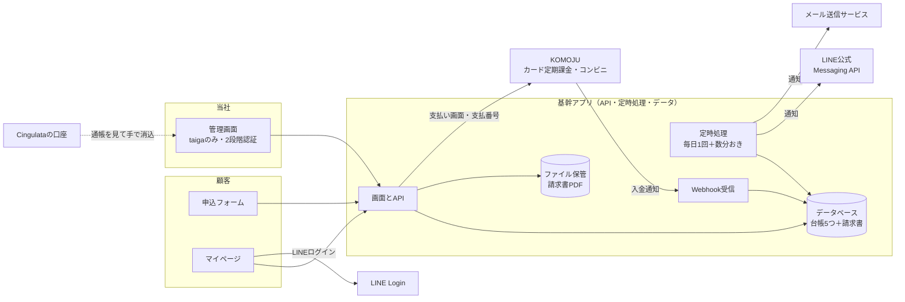
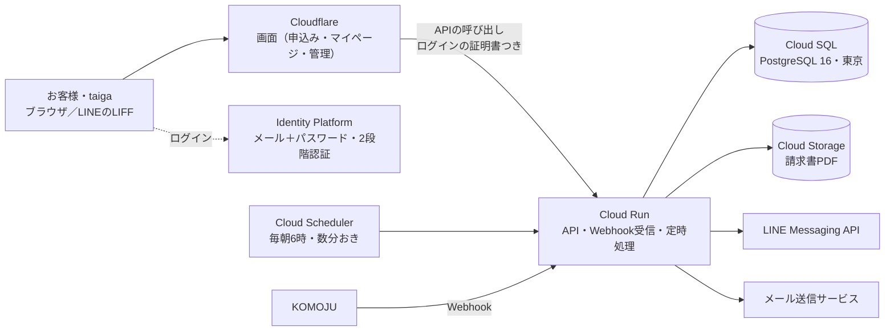
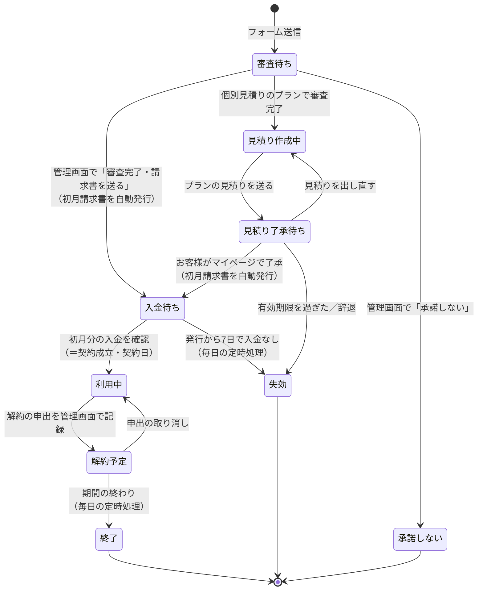
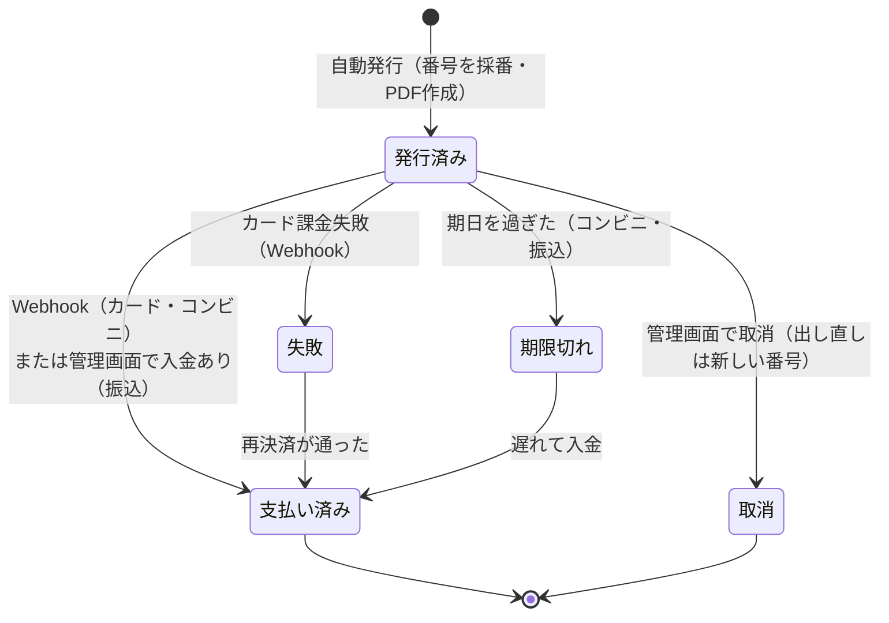
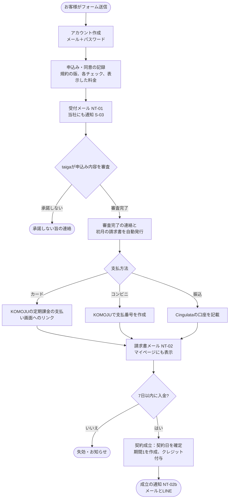
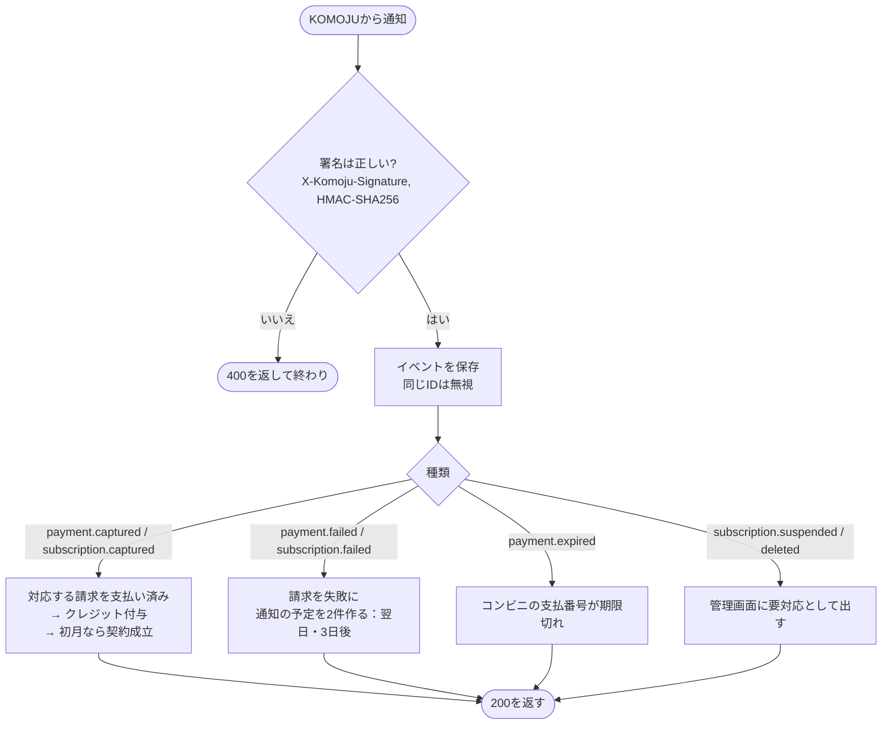
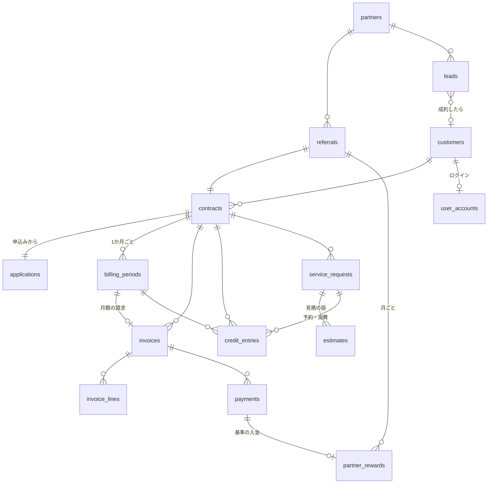

# コビトサポート（kobITo Support）基幹システム 設計書 v1

> **2026-10-29 更新（taiga決定）：プレオープンの範囲を絞る。**
> - **コンビニ払いは当面なし。** 支払方法は「クレジットカード（KOMOJU定期課金）」と「銀行振込」の2つだけ。コンビニ手数料の請求行・支払番号・コンビニ用の状態や画面は作らない（コンビニ手数料の税の扱いも不要）。あとで足せるよう、DBの `payment_method` の値などは残してよいが、画面・処理・申込フォームの選択肢には出さない。
> - **LINE公式アカウントは一旦なし。** LINE通知、LINEログイン／LINE連携（MY-02、F-13）、LIFF、リッチメニューは作らない。ログインは**メール＋パスワードのみ**。お客様への通知は**メールとマイページ**、お客様からの連絡窓口は**メール**。通知の `channel` は `email` のみ使う（`line` は将来用に残す）。
> - **連絡用メールアドレスは `info@singularta.com`**（設定値 `contact_email`、規約・特商法・メール送信元に使う。ドメイン綴りは taiga 確認待ち）。
> - 本文中の「コンビニ」「LINE」の記述は、上記の範囲外の将来案として読み、実装しない。


2026-10-23 作成。スレッド「基幹システムの設計」。サービス名は2026-10-24にtaigaが「コビトサポート」に変更（旧Small Plus。要件定義書など他の資料にはまだ旧名が残る）。前提は [要件定義書 v1](../business-design/requirements-definition-v1.md)（以下「要件」）と [システム化の範囲 v3](../business-design/system-boundary-v3.md)。**要件で「決定」のものは変えていません。この文書の作り方（構成・技術・テーブル）はすべて提案です。** テーブル定義の本体は [schema-v1.sql](schema-v1.sql)。

**2026-10-26 更新**：料金の表示が**税別**に変わった（taiga）。ライト5,000／スタンダード10,000／プレミアム15,000円、追加クレジット4,000円は**税抜の金額**で、請求のときに消費税10%を足す（例：5,000円 → 税込5,500円）。この文書のお金の持ち方は税抜を基準に直した（6章の決めごと）。

**2026-10-25 更新**（画面モックのスレッド経由のtaigaの指示）：申込み後の当社の確認を「**審査**」と呼ぶ（審査待ち／審査完了・請求書を送る／承諾しない）。申込フォームは5つの手順に分ける。見積に「作業内容・完了の状態・含まれないもの・ご用意いただくもの」を持たせる。技術はGCP＋Cloudflareで**決定**（taiga 2026-10-25）。プランに「**個別見積り**」を追加（3.5章）。ディレクトリ構成は12章。

**まず見てほしいところ：** 1章（全体の形）、2章（技術の選び方）、9章（taigaさんに決めてほしいこと 5つ）。

---

## 1. 全体の形



- **画面（Cloudflare）とAPI（GCPのCloud Run）の2つ**に分ける。申込フォーム・マイページ・管理画面は1つの画面のアプリに、API・Webhookの受け口・定時処理は1つのCloud Runにまとめる（2章）。
- 外のサービスは KOMOJU（カード・コンビニ）、LINE（通知とログイン）、メール送信、の3つだけ。会計ソフトとはつながない（請求書の控えをCSVで出せるようにしておく）。
- **カード情報は一切持たない。** カードはKOMOJUの画面で入力し、こちらが持つのはKOMOJUの「定期課金のID」と「支払いのID」だけ（どちらもカード情報ではなく、取引の番号）。

---

## 2. 技術の選び方（**決定**：taiga 2026-10-25、GCP＋Cloudflare）

taigaの方針（2026-10-25）：**バックエンドはGCP、フロントはCloudflare**。それに合わせた構成です（旧案のSupabase＋Vercelは取り下げ）。



| 部分 | おすすめ | 理由・メモ |
|---|---|---|
| 画面（フロント） | **Cloudflare（Workers の静的配信／Pages）に React＋Vite の画面**を置く | 画面はAPIを呼ぶだけにして、データベースには直接つながない。LIFFもこの画面を開く。サーバー側の描画が要らないので、Next.jsより単純で安い |
| API・Webhook・定時処理 | **Cloud Run（東京 asia-northeast1）**、TypeScript（Hono などの軽いフレームワーク） | 使った分だけの課金で、20社ならほぼ無料枠。KOMOJUのWebhookもここで受ける |
| データベース | **Cloud SQL for PostgreSQL 16（東京）**、いちばん小さい構成から | [schema-v1.sql](schema-v1.sql) をそのまま使える。毎日の自動バックアップと時点復元を有効にする |
| ログイン | **Identity Platform**（Firebase Authentication の上位版） | メール＋パスワード（自作で保管しない＝MY-01）、管理者の2段階認証（TOTP、P-05・ADM-07）。画面はログインの証明書（IDトークン）をAPIに付けて送り、Cloud Runが検証する |
| LINEログイン・LIFF | **Cloud RunでLINEのIDトークンを検証 → Identity Platformのカスタムトークンを発行** | LIFFでもブラウザのLINEログインでも同じ仕組みで済む。`line_user_id` で顧客を探し、連携済みならログイン画面を出さない |
| 定時処理 | **Cloud Scheduler** → Cloud Run を呼ぶ | 毎朝6時（期間の切り替え・失効・削除）、5分おき（通知の送信） |
| ファイル | **Cloud Storage** | 請求書PDF。ダウンロードは期限つきの署名URLで渡す |
| 秘密の値 | **Secret Manager** | KOMOJUのAPIキー・Webhookの秘密の文字列、LINEのチャネルの秘密の値 |
| メール送信 | **Resend** または SendGrid | GCPには手軽なメール送信がないので外部を使う |
| LINE | **Messaging API**（通知）＋ **LINE Login／LIFF** | — |
| 請求書PDF | Cloud RunでHTMLからPDFを作る | 外部の請求書サービスとの二重管理を避ける |

**つなぎ方：** 画面は `app.（ドメイン）`、APIは `api.（ドメイン）` に分ける。ログインはCookieではなく「IDトークンをヘッダーに付ける」方式にするので、ドメインが分かれても問題になりにくい。DNSはCloudflareで管理し、APIはCloud Runのカスタムドメインにつなぐ。

**閲覧制限：** 画面がデータベースに直接つながらないので、Supabaseの行ごとの制限の代わりに、**APIの全ての読み書きで「ログインした人の顧客ID」で絞る**作りにする（管理者だけが全件を見られる）。テストでこの絞り込みを必ず確かめる。

**月の費用の目安（20社まで）：** Cloud SQL（いちばん小さい構成＋容量）が月1,500〜3,000円ほどで、ほぼこれだけ。Cloud Run・Scheduler・Storage・Identity Platform・Cloudflareは、この規模なら無料枠に収まる見込み。ほかにメール送信（無料枠）、LINE公式（通数次第）。金額は作るときに料金表で確かめる。

**作り始めに試すこと：** ①LIFFとブラウザのLINEログインからカスタムトークンでログインできるか ②Cloud RunからCloud SQLへの接続と、Webhookの受信 ③Cloudflareの画面からAPIへの呼び出し（別ドメイン間の許可設定）

---

## 3. 期間の考え方（課金・付与・失効の中心）

要件 PAY-10 の「契約日から1か月単位」をシステムで扱うため、**「期間」**という単位を置きます。

- **契約日 ＝ 初月分の入金を確認した日**（カードは決済が通った日、コンビニは入金通知の日、振込は管理画面で入金ありを付けた日）。
- 期間 n は「契約日の n か月後の同じ日」から「その前日まで」。例：10/23契約 → 10/23〜11/22、11/23〜12/22 …
- 月末の契約（29〜31日）は、その日がない月は**月の末日**を始まりにする（例：1/31契約 → 2/28〜3/30、3/31〜4/29）。KOMOJUの定期課金の課金日と同じ決め方かは確認が要る（7章 KOMOJU（カード）②）。
- 1つの期間に、**請求1件・クレジット付与1件・期間末の失効1件**がぶら下がる。

**カードの場合は自然に揃う：** KOMOJUの定期課金は「登録した日と同じ日に毎月課金」なので、初月を決済した日＝契約日＝毎月の課金日になります。振込・コンビニも同じ日付で請求書を出すので、3つの支払方法で期間がそろいます。

---

## 3.5 個別見積りのプラン（taiga 2026-10-25の指示で追加）

ライト／スタンダード／プレミアムのほかに、**お店ごとに月額とクレジット数を決める「個別見積り」**のプランを持ちます。読み方：毎月の契約で、金額と内容をお店ごとに見積る形（単発の作業ではない）と解釈しています。単発のつもりなら教えてください。

- 申込フォームのプランの選択肢に「個別見積り（ご相談のうえお見積り）」を足す。最終確認では金額の代わりに「審査のあとにお見積りをお送りします」と出す。
- 審査のあと、taigaさんが**プランの見積り**（月額（税抜）、毎月のクレジット数、内容の説明、見積りの有効期限）を作ってマイページとLINEで送る。お客様がマイページで「この内容で申し込む」を押すと、初月の請求書が自動で出る（以降は他のプランと同じ）。
- 見積りの出し直しは新しい版にする（依頼の見積と同じ考え方）。有効期限（案：送ってから14日）を過ぎたら申込みは失効。
- 毎月の請求・付与は、了承した見積りの金額とクレジット数で行う。KOMOJUの定期課金は、その金額で作る。パートナーの報酬の基準は、その月額（表示価格・税抜。6章）。
- プランの金額は `billing_periods` に期間ごとの写しを持つので、固定のプランと個別見積りを同じ処理で扱える。

**ほかの資料への影響：** 申込フォームの要件（F-07、K-01）、LPの料金表、規約・特商法の料金の書き方（「個別にお見積り」の記載）。取りまとめ役に共有します。

## 4. 状態の流れ

### 4.1 申込み・契約



- 「見込み」（KPIのアポ・商談）は契約の状態にせず、別の表（leads）で持ちます。申込みが来たら見込みと結びつけます。理由：見込みの段階ではメールアドレスもアカウントもないことが多いため。
- **利用中の中の「支払い遅れ」**は状態を増やさず、その期間の請求が「未払い」で見分けます（10章の未決と関係）。

### 4.2 請求



- 請求書は発行後に書き換えない（INV-04）。取消は「取消日・理由・出し直し先」を記録し、PDFには「取消」を重ねたものを残す。

### 4.3 依頼

`受付済み → 見積・了承待ち → 作業中 → 完了`（＋ `取り下げ`）。見積を出すとLINEで通知（NT-06）、お客様がマイページで「了承する」を押すと作業中に進む。

---

## 5. 主な処理の流れ

### 5.1 申込みから契約成立まで



- **パスワードは申込みのときに設定**してもらう案（F-12）。理由：入金待ちの間も、マイページで請求書と支払い方法を見られるため。承諾しない・失効のアカウントはログインしても「お申込みは終了しました」だけを出す。
- 「審査完了・請求書を送る」の操作で、初月の請求書番号はその時点で採番する。
- 申込フォームは5つの手順（お店／プラン／お支払い／ご要望／確認）に分けるが、**途中の入力はブラウザの中だけで持ち、最後の送信でまとめて保存する**（途中の保存用の表は作らない）。送信の直前にサーバーで全項目をもう一度検証する。

### 5.2 毎月の更新（定時処理、毎日 朝6時）

1. **期間の切り替え：** 今日が新しい期間の始まりの契約ごとに、
   - 前の期間の残りクレジットを失効（`expire` の行を追加）
   - 新しい期間を作る
   - 請求書を自動発行（INV-01）。振込・コンビニは期日つき（9章 #1）、コンビニは支払番号をKOMOJUで作る
   - カードはKOMOJUが同じ日に自動課金するので、請求書は「カードで自動決済します」と書いて発行し、Webhookで支払い済みにする
2. **クレジットの付与：** 請求が支払い済みになった時点で付与（PAY-05）。カードは当日中、振込・コンビニは入金のとき。
3. **失効・終了：** 入金待ちで7日を過ぎた申込みを失効。解約予定で期間の終わりを過ぎた契約を終了。
4. **カード失敗の通知：** 失敗の翌日と3日後に、まだ払われていない請求へ LINEとメールで通知（NT-05）。
5. **削除：** 削除の予定日を過ぎた個人情報を消す（8章）。

同じ処理を2回走らせても二重にならないよう、「期間」「請求」「通知」には一意のキーを付けます（例：契約ID＋期間番号）。

### 5.3 KOMOJUの入金通知（Webhook）



- KOMOJUは失敗すると最大25回・25日間まで送り直すので、**受け取ったらまず保存して200を返し、処理は保存したイベントから行う**（途中で落ちても取りこぼさない）。
- 公式の通知の種類と署名の方式は [KOMOJU Webhooks](https://docs.komoju.com/en/docs/introduction/core-concepts/webhooks) で確認済み（2026-10-23）。

### 5.4 銀行振込の入金確認（ADM-03）

管理画面の「入金確認」に、振込で未払いの請求が並ぶ。taigaさんが通帳と照らして「入金あり（入金日）」を押すと、支払い済み→クレジット付与→（初月なら）契約成立。振込名義と請求を見分けやすいよう、**請求書に「振込名義の前に請求番号の下4桁を入れてください」と書く**案です。

### 5.5 依頼と見積の了承（MY-06）

1. LINEで相談が来る → taigaさんが管理画面で依頼を登録（受付済み）
2. 見積を入れて送信 → LINEで「マイページで了承を」と通知。見積の中身：**必要C・目安日・作業内容（箇条書き、必須）・完了の状態（必須）・含まれないもの・お客様にご用意いただくもの**。送信した見積は書き換えず、出し直すときは新しい版にする（了承したのがどの版か残すため）
3. お客様が了承 → 了承の日時を記録、作業中へ。**この時点でクレジットを「予約」**（残りから引いて見せる）
4. 完了 → 予約を消費に変える（`consume` の行）。実際の時間も記録

予約を入れる理由：了承済みの依頼が複数あると、残りクレジットを超えて了承できてしまうため。**了承の時点で残りが足りなければ「了承」ボタンを押せず、「追加クレジットのご相談はLINEへ」と出す。**

---

## 6. データモデル

台帳5つ（顧客・契約／クレジット／請求・入金／依頼／紹介・報酬）を、表に分けると下のようになります。列の全部は [schema-v1.sql](schema-v1.sql)。



| 表 | 何を持つか | 要件 |
|---|---|---|
| `customers` | 店名、担当者、請求先、メール、電話、お客様のインボイス番号、LINEのユーザーID（連携時）、案内メールの同意、削除予定日 | F-01〜F-09、F-13、C-03 |
| `user_accounts` | Identity Platformのユーザーと顧客の結びつけ、役割（customer／admin） | MY-01、MY-02 |
| `applications` | 申込みの中身と**同意の証拠**：送信日時、規約・ポリシーの版、各チェックの値、最終確認で表示した料金（JSON）、紹介コード、IPとブラウザ | R-01〜R-05、C-01〜C-04 |
| `contracts` | 状態、プラン、支払方法、契約日（期間の起点日）、解約の申出日・終了日、KOMOJUの定期課金ID、紹介 | 7章 顧客・契約 |
| `plans` | ライト／スタンダード／プレミアム／**個別見積り**、税抜額、クレジット数（個別見積りは空）、有効期間（料金改定に備えて履歴で持つ） | F-07 |
| `plan_quotes` | 個別見積りの版：月額（税抜）、クレジット数、内容、有効期限、送信日時、了承日時・了承した人 | 3.5章 |
| `billing_periods` | 契約ID、期間番号、始まり・終わりの日、その期間の月額（税抜）とクレジット数の写し | PAY-10 |
| `invoices` | 請求番号（連番）、種類（初月／月額／追加C）、状態、発行日、期日、税抜の小計、消費税、税込合計、支払方法、コンビニ支払番号、取消・出し直し、PDFの場所、**発行時点の当社情報（登録番号など）の写し** | INV-01〜06 |
| `invoice_lines` | 行（月額／追加クレジット／コンビニ払い手数料）、税率、金額 | INV-03、INV-05 |
| `payments` | 入金1件。方法、金額、入金日、確認方法（Webhook／手動）、KOMOJUの支払いID | 7章 請求・入金 |
| `credit_entries` | 1行＝1回の動き：付与／追加／予約／予約取消／消費／失効。数（＋／−）、期間、依頼、請求 | 7章 クレジット |
| `service_requests` | 届いた日、要約、緊急、状態、了承した見積、完了日、実際の時間 | 7章 依頼、MY-05 |
| `estimates` | 見積の版：必要C、目安日、作業内容（箇条書き）、完了の状態、含まれないもの、ご用意いただくもの、送信日時、了承日時・了承した人 | MY-06 |
| `partners` / `referrals` / `partner_rewards` | パートナー、紹介コード、種類（アポ10%／成約20%）、紹介した契約、月ごとの報酬（基準＝入金のあった月額の税抜額、最大12か月、解約で停止） | 7章 紹介・報酬 |
| `leads` | 見込み：経路（パートナー／LP／直接）、アポ日、商談日、結果 | KPI |
| `notifications` | 送る予定と結果（種類、手段、宛先、予定日時、送った日時、失敗理由）。一意キーで二重送信を防ぐ | 8章 NT- |
| `komoju_events` | 受け取ったWebhookの原文、処理結果 | PAY-05 |
| `audit_logs` | 管理画面の操作の記録（誰が・いつ・何を） | P-05 |
| `settings` | サービス名（**コビトサポート（kobITo Support）を1か所で差し替え** G-01）、当社名・住所・登録番号、振込先、コンビニ手数料、通知の文面 | G-01、INV-02 |

**決めごと：**

- **残りクレジット＝その期間の行の合計**（付与＋追加 − 予約 − 消費 − 失効）。残り数を別の列に持たないので、ずれません。
- **お金は円の整数**で持つ。**金額は税抜を基準**にする：プランの月額・追加クレジット・手数料の行は税抜で持ち、請求書の消費税は「**税抜の小計 × 10% の端数を切り捨て**」を請求書・税率ごとに1回だけ計算し、税込合計＝税抜の小計＋消費税（例：5,000円 → 消費税500円・税込5,500円、10,000円 → 1,000円・11,000円、15,000円 → 1,500円・16,500円、追加4,000円 → 400円・4,400円、個別見積りの12,345円 → 1,234円・13,579円）。端数処理は1つの関数にまとめ、切り捨てを仮の既定として、税理士の確認で変えられるようにする。**お客様が実際に払う額は税込合計**：KOMOJUのカード定期課金・コンビニの支払い・振込の請求額、`payments.amount` はすべて税込合計。請求書には税抜の小計・消費税・税込合計をすべて出す（適格請求書の記載事項でもある）。
- **パートナー報酬の基準（確定 taiga 2026-10-26「営業報酬は変わらず」）：** 入金のあった月の**月額の表示価格（税抜）**（5,000円 → 成約20%で1,000円）。税込にはしない。ただし**支払いは「報酬（税抜）＋消費税」**（taiga 2026-10-26：1,000円＋消費税＝1,100円）。台帳は報酬（税抜）と消費税を別に持つ。パートナーが免税事業者・個人の場合の扱い、パートナーからの請求書（適格請求書）の受け取りの要否は未決。
- **請求番号：** `KS-2026-00001` の形（頭の「KS」は設定値で、名称が変わっても連番はそのまま続けられる）。年ごとの連番を表1つで採番し、欠番・重複を出さない（取消しても番号は消さない）。
- **閲覧制限：** お客様は自分の顧客IDの行だけ読める（APIで絞る、2章）。読み書きはすべてCloud RunのAPIを通し、画面からデータベースには直接つながない。

---

## 7. 外部連携のまとめ

| 相手 | 使うもの | こちらが持つもの | 作り始めに確かめること |
|---|---|---|---|
| KOMOJU（カード） | 定期課金（支払いリンク型か、APIのSubscriptions） | 定期課金ID、支払いID | ①**リンクからの支払いに「どの請求か」を結びつける番号を載せられるか**（無理ならKOMOJUの顧客IDを持つ案、9章 #3）②月末日の扱い ③失敗後に自動で再試行するか ④金額の変更：公開仕様では定期課金の「更新」がなく作成・削除のみ。**プラン変更は「今の定期課金を止めて、新しい金額で作り直す」**になり、お客様にもう一度カードを入れてもらう可能性がある |
| KOMOJU（コンビニ） | 支払い（Payments API、konbini） | 支払いID、支払番号、期限 | 支払番号の期限の最長、発行手数料の額（要件 10章 #12） |
| KOMOJU（Webhook） | 上の5.3 | イベント原文 | 署名用の秘密の文字列の設定 |
| LINE Messaging API | 通知の送信（push） | LINEのユーザーID | 公式アカウントの友だち追加と連携の順番（連携していない人にはメールだけ） |
| LINE Login | マイページのログイン・連携 | LINEのユーザーID | IDトークンの検証とカスタムトークンの発行（2章） |
| LINE（LIFF・リッチメニュー） | リッチメニュー6つ（マイページ／相談・依頼／残りのクレジット／請求書／よくある質問／お問い合わせ）からLIFFでマイページを開く。見積の通知から見積画面を直接開く | LINEのユーザーID | LIFFのIDトークンをサーバーで検証し、`line_user_id` で顧客を探してログイン状態を作る（連携済みならログイン画面を出さない）。未連携ならメール＋パスワードでログインして連携。リッチメニューはLINE公式の管理画面で設定（アプリ側は作らない） |
| メール送信 | 申込み受付、請求書、成立、失敗など | 送信ID | 送信元ドメインの設定（SPF・DKIM）で迷惑メールに入りにくくする |

**通知の送り方：** すべて `notifications` に「送る予定」を入れ、数分おきの処理が送る。失敗したら3回まで送り直し、管理画面に出す。LINE未連携のお客様にはメールだけ送る。

---

## 8. 守ることと消すこと

- **カード情報：** 持たない。画面にも入力欄を作らない（P-02）。
- **管理画面：** taigaさんだけ、2段階認証（TOTP）必須。操作は `audit_logs` に残す。
- **要配慮の情報：** 入力欄を作らない。自由記入欄に注意書き（P-03）。
- **保存と削除（END-06、R-06）：** 契約・請求・入金・同意は**7年**残す。それ以外（店の詳細、依頼の内容、LINEのID、ログイン）は**解約（または失効・承諾しない）から1年**で消す。消すときは行ごと消さず、名前・連絡先・依頼の内容を空にして「削除済み」を付ける（7年残す請求書と台帳の数字はそのまま残るように）。請求書PDFは7年残すので、宛名はPDFの中に残る。
- **解約後のマイページ：** 請求書のダウンロードだけ**終了から1年**（ログインの削除と同じ時期）できるようにする案（END-05）。
- **バックアップ：** Cloud SQLの毎日の自動バックアップと時点復元。

---

## 9. taigaさんに決めてほしいこと（2026-10-25に5点とも決定）

| # | こと | 決定（おすすめどおり） |
|---|---|---|
| 1 | ✓ **2か月目以降の振込・コンビニの支払期日** | 請求書の発行から**7日**（初月と同じ）。過ぎたら、期日の翌日と3日後にLINEとメールで知らせる（カードの失敗と同じ扱い） |
| 2 | ✓ **支払いが遅れている間のクレジット** | 入金があるまで付与しない（要件 PAY-05 どおり）。マイページには「お支払いの確認後に使えます」と出す。ただし管理画面から**「先に使えるようにする」**ボタンで例外を作れる（規約 第11条3項の運用） |
| 3 | ✓ **カードの支払いと請求の結びつけ**（承認済み。KOMOJUで番号を載せられるかの確認は作り始めに行い、無理なら顧客ID案で再相談） | 支払いリンクに請求番号を載せられればそれで結ぶ。載せられない場合は、KOMOJUの「顧客ID」（カード番号ではなく番号札）を持って結ぶ。これは「長期トークンも持たない」の決定に触れるので、その場合だけ改めて相談します |
| 4 | ✓ **期間をまたいだ依頼のクレジット** | 了承した期間のクレジットから引く（予約したもの）。作業が次の期間にずれても、了承の時点で予約したクレジットは失効させない |
| 5 | ~~技術の組み合わせ~~ | **決定**（taiga 2026-10-25）：GCP（Cloud Run＋Cloud SQL＋Identity Platform）＋Cloudflare（画面）。LINEログインのつなぎ方は最初に試作して確かめる |

---

## 10. 要件のほうで残っていること（設計で待つもの）

- コンビニ払いの発行手数料の額と消費税の扱い（設定値で持つので、決まったら入れるだけ）
- 当社のインボイス登録番号（設定値。実装のときに受け取る）
- 規約の版の表記ルール（`applications` に版の文字列を残すだけなので、表記が決まれば合わせる）
- 弁護士・税理士の確認（請求書の記載、端数処理、保存期間）

## 11. 画面一覧（画面モックのスレッドと共有）

| 区分 | 画面 | 主な要件 |
|---|---|---|
| 申込み | 5つの手順（お店／プラン／お支払い／ご要望／確認）→ 受付完了（審査→請求書→入金で成立の案内）。プランに「個別見積り」を追加 | F-、C-、K-、S-01 |
| マイページ | **プランの見積り**（個別見積り：月額・クレジット数・内容・有効期限、「この内容で申し込む」ボタン） | 3.5章 |
| 認証 | ログイン（メール＋パスワード／LINEで続ける）、パスワード再設定、LINE連携 | MY-01、MY-02 |
| マイページ | ホーム（契約の状態・今期の残りクレジットと期限・了承待ちの見積・未払いの請求） | MY-03、MY-04 |
| マイページ | 依頼の一覧・詳細（見積の了承ボタン） | MY-05、MY-06 |
| マイページ | 請求書の一覧（PDF、支払いの案内：カード／支払番号／振込先） | MY-07 |
| マイページ | 契約・アカウント（プラン、次の請求日、LINE連携、追加・変更・解約は「LINEで連絡」） | MY-03、MY-08 |
| マイページ | 入金待ちの間の画面（初月の請求書と支払い方法だけ） | 1章 |
| 管理 | ダッシュボード（今日やること：審査待ちの申込み、プランの見積りを作る申込み、見積を作る依頼、振込の消込、失敗した課金、了承済みの依頼、KPI） | ADM- |
| 管理 | 申込みの審査（審査完了・請求書を送る／承諾しない）。個別見積りは「審査完了・見積りを作る」 | ADM-01 |
| 管理 | **プランの見積りの作成・送信・出し直し** | 3.5章 |
| 管理 | 顧客一覧・顧客の詳細（契約、期間、クレジットの動き、請求、依頼、解約予定にする） | ADM-01、END-01 |
| 管理 | 依頼（登録、見積の送信、完了） | ADM-02 |
| 管理 | 請求書（一覧、取消と出し直し）、振込の入金確認 | ADM-03、ADM-04 |
| 管理 | 定期課金（状態、止める） | ADM-05 |
| 管理 | パートナーと報酬（月ごと・パートナーごと） | ADM-06 |
| 管理 | 削除予定の一覧、設定（サービス名・当社情報・振込先・手数料・通知文面） | END-06、G-01 |
| 契約開始 | 契約開始のお知らせ（依頼の流れ、LINE連携の案内）。成立後の初回ログインで表示 | NT-02b |
| LINE | リッチメニュー、見積の通知メッセージ（LIFFで見積画面へ）、メニューからLIFFでホーム | MY-02、NT-06 |

画面モック（スレッド「基幹システムの画面モック」）：[system-mock/index.html](../system-mock/index.html)、画面番号は c01〜c12（お客様）、l01〜l03（LINE）、a01〜a08（管理、a04-2を含む）。画面のつながりは [画面遷移図](screen-flow-v1.html)、URL・API・状態の変化は [画面遷移・実装仕様](screen-flow-spec-v1.md)（実装担当者向け）。管理の「今日やること」には「見積を作る依頼（受付済み）」も入る。配色は落ち着いた紺（ロゴだけ黄色、taigaの判断）。

段階（境界 v3 の6章）：②で「追加クレジットの購入」、③で「プラン変更・解約の申出」と「パートナー用ページ」を足します。

## 12. ディレクトリ構成（提案）

1つのリポジトリに、画面・API・共通部品をまとめる形（モノレポ。pnpm の workspaces）にします。料金・税・期間の計算を画面とAPIで同じ部品から使えるのが一番の理由です。

```
kobito-support/
├─ apps/
│  ├─ web/                 画面（Cloudflare）：React＋Vite
│  │  └─ src/
│  │     ├─ features/      画面のまとまりごと：apply（申込み）/ mypage / admin / liff
│  │     ├─ components/    共通の部品（ボタン・表・フォーム）
│  │     ├─ lib/           APIの呼び出し、ログイン（Identity Platform）
│  │     └─ routes/        画面の行き先（URL）
│  └─ api/                 API（Cloud Run）：TypeScript＋Hono
│     └─ src/
│        ├─ modules/       業務のまとまりごと（下の表）
│        │  └─ <まとまり>/  routes（受け口）/ service（業務の決まり）/ repository（データベース）
│        ├─ integrations/  外のサービス：komoju / line / mail / pdf
│        ├─ jobs/          定時処理：daily（期間の切り替え・失効・削除）/ notifications（通知の送信）
│        ├─ webhooks/      KOMOJUの受け口（保存してから処理）
│        └─ platform/      ログインの検証、権限の絞り込み、操作の記録、設定値
├─ packages/
│  └─ shared/              画面とAPIで共有：型、入力チェック（zod）、料金・税・期間の計算
├─ db/
│  └─ migrations/          テーブル定義の変更履歴（schema-v1.sql を最初の1本にする）
├─ infra/                  GCPとCloudflareの設定（Terraform）
└─ docs/                   この設計書など
```

**APIの中の分け方：** 「業務のまとまり（モジュール）ごとに縦に分け、その中を受け口・業務の決まり・データベースの3層に分ける」形（よく「モジュラーモノリス＋レイヤード」と呼ばれる形）。20社規模でサービスを分ける必要はないが、まとまりの境目をはっきりさせておくと、あとで直す範囲が狭くて済みます。

| まとまり | 持つもの |
|---|---|
| applications | 申込み・同意の記録・審査 |
| contracts | 契約の状態、期間、解約、プランの見積り（個別見積り） |
| billing | 請求書・採番・PDF・入金・振込の消込 |
| credits | 付与・予約・消費・失効、残りの計算 |
| requests | 依頼と見積の版、了承 |
| partners | 紹介・報酬の計算 |
| notifications | 通知の予定と送信（LINE・メール） |
| accounts | ログイン、LINE連携 |

**決まりごと：** 業務の決まり（service）は外のサービスやデータベースを直接触らず、`repository` と `integrations` を通す。これで、KOMOJUやLINEを偽物に差し替えてテストできる。お金・期間・状態の変わり方は `packages/shared` と各 `service` に単体テストを書く。
